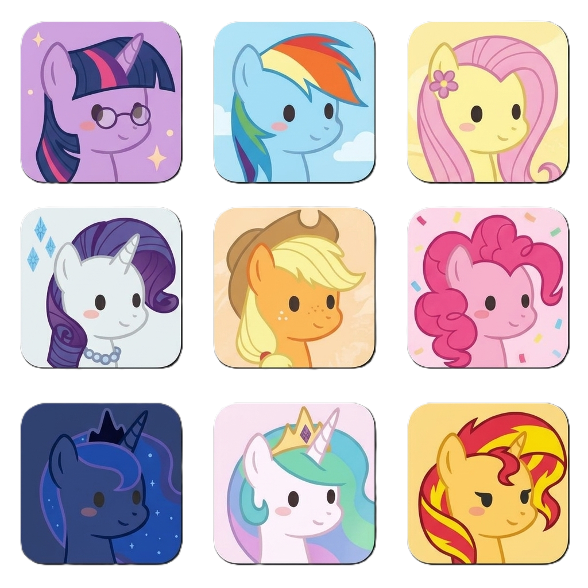

<div align="center">



# My Little Pony: Friendship is Magic Themes

**9 pastel dark themes for VS Code, Cursor, Windsurf & VSCodium — the Mane 6
and the Princesses of Equestria, styled with a Catppuccin-inspired design
system.**

[](LICENSE)
[](https://code.visualstudio.com/)

</div>

A low-fatigue theme collection built on **layered dark surfaces** (`crust` →
`mantle` → `base` → `surface0-2` → `overlay0-2`), **soft pastel accents**, full
syntax & semantic highlighting, bracket pair colorization, a 16-color terminal
palette, Git decorations — and a smart theme switcher with live preview,
keyboard cycling, workspace overrides, and a Celestia-by-day / Luna-by-night
auto-schedule.

## Themes

| Theme | Character | Signature accents |
| --- | --- | --- |
|  | Twilight Sparkle | `#cba6f7` mauve · `#f5c2e7` pink · `#f9e2af` cream |
|  | Rainbow Dash | `#89dceb` sky · `#74c7ec` sapphire · `#f38ba8` coral |
|  | Fluttershy | `#f9e2af` buttercream · `#f5e0dc` rosewater · `#a6e3a1` sage |
|  | Rarity | `#cdd6f4` pearl · `#89b4fa` sapphire · `#cba6f7` amethyst |
|  | Applejack | `#fab387` peach · `#f9e2af` yellow · `#a6e3a1` orchard |
|  | Pinkie Pie | `#f2cdcd` flamingo · `#f5c2e7` pink · `#89dceb` sky |
|  | Princess Luna | `#89b4fa` starry blue · `#bac2de` lunar silver · `#b4befe` lavender |
|  | Princess Celestia | `#f9e2af` solar gold · `#fab387` peach · `#94e2d5` teal |
|  | Sunset Shimmer | `#fab387` peach · `#eba0ac` maroon · `#f38ba8` coral |

Every theme shares the same layered surface hierarchy, Catppuccin-style
invisible structural borders, accent-driven chrome (activity bar icons, tabs,
focus rings), pastel-softened syntax colors for long sessions, and per-
character tinted widget cards. No pure blacks, no neon.

## Features

- **$(sparkle) Status bar switcher** — click the sparkle item (bottom-right)
  to open a quick pick with live preview; selection applies instantly and
  reverts if you cancel.
- **Keyboard cycling** — `Ctrl+Alt+T` (`Cmd+Alt+T` on macOS) cycles all 9 themes.
- **Workspace overrides** — bind a pony theme to a single workspace's
  `.vscode/settings.json`.
- **Auto-schedule** — Celestia by day, Luna by night, with configurable hours.

## Installation

From the VS Code Marketplace / Open VSX:

1. Open the Extensions view (`Ctrl+Shift+X`).
2. Search for **"My Little Pony: Friendship is Magic Themes"**.
3. Install, then pick a theme via `Preferences: Color Theme` or the status bar
   sparkle item.

From source:

```bash
git clone https://github.com/Arviixzuh/vscode-mlp-themes.git
cd vscode-mlp-themes
npm install
npm run compile
npm run package   # produces mlp-fim-themes-*.vsix
code --install-extension mlp-fim-themes-*.vsix
```

## Commands

| Command | Keybinding | Description |
| --- | --- | --- |
| `MLP Themes: Pick Theme` | — | Quick pick with **live preview**; highlights apply instantly and revert on cancel |
| `MLP Themes: Next Theme` | `Ctrl+Alt+T` (`Cmd+Alt+T` on macOS) | Cycle through all 9 themes |
| `MLP Themes: Set Workspace Theme` | — | Bind a theme to the current workspace's `.vscode/settings.json` |

## Settings

```jsonc
{
  "mlpThemes.showStatusBarItem": true,

  // Celestia by day, Luna by night — checked on startup and every minute.
  "mlpThemes.autoSchedule.enabled": false,
  "mlpThemes.autoSchedule.dayTheme": "Princess Celestia",
  "mlpThemes.autoSchedule.nightTheme": "Princess Luna",
  "mlpThemes.autoSchedule.dayStartHour": 7,
  "mlpThemes.autoSchedule.nightStartHour": 19
}
```

`dayStartHour` / `nightStartHour` accept `0–23` local time and may wrap past
midnight (e.g. `dayStartHour: 9`, `nightStartHour: 2` works as expected).

## Development

```bash
npm install
npm run build:themes   # regenerate themes/*.json from src/palette-generator.ts
npm run compile        # strict TypeScript build → out/
npm run lint           # typecheck only
npm run package        # vsce package → .vsix
```

Theme JSON is fully generated — edit `src/palette-generator.ts` (character
palettes live there) and re-run `npm run build:themes`. The script validates
each generated file and prints WCAG contrast ratios for foreground, muted, and
status bar text.

## Credits

Created by [**Arviixzuh**](https://github.com/Arviixzuh).

## License

[MIT](LICENSE) © Arviixzuh.

*My Little Pony: Friendship is Magic* and its characters are trademarks of
Hasbro. This is an unofficial fan project, not affiliated with or endorsed by
Hasbro.
